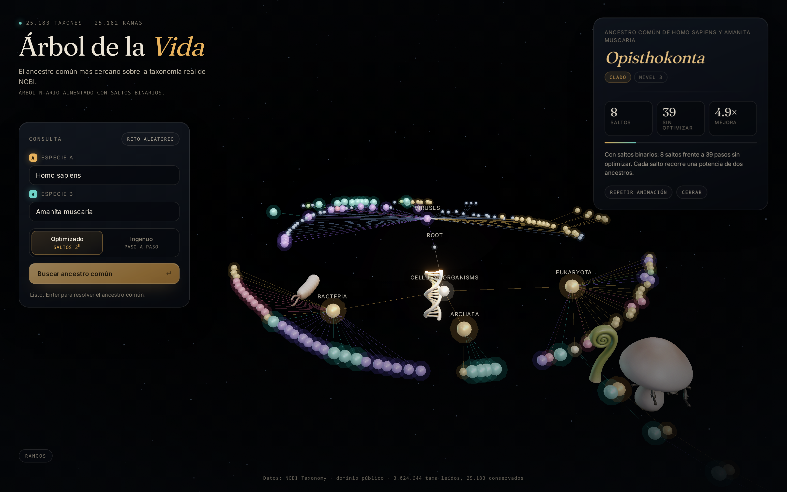

# Árbol de la Vida

**Ancestro común más cercano sobre la taxonomía real de NCBI**, visualizado como un árbol tridimensional navegable.



---

## 1. El caso de estudio

> Dos especies. ¿Cuál es su antepasado compartido más reciente?

En biología evolutiva esa pregunta se responde con el **LCA** (*lowest common ancestor*, ancestro común más cercano) y es la operación fundamental de la taxonomía comparada: sirve para saber cuándo se separaron dos linajes, para clasificar un taxón nuevo o para detectar si dos secuencias pertenecen al mismo grupo.

La aplicación resuelve la pregunta sobre la **taxonomía oficial de NCBI** (3.024.644 taxones en el volcado original) y muestra el proceso, no solo el resultado: los dos linajes ascienden por el árbol, se ve cada salto y, al encontrarse, aparece el ancestro con su rango y su profundidad.

Ejemplos que el sistema responde al instante:

| Especie A | Especie B | Ancestro común |
|---|---|---|
| *Homo sapiens* | *Amanita muscaria* | **Opisthokonta** (clado) |
| *Homo sapiens* | *Mus musculus* | **Euarchontoglires** |
| *Homo sapiens* | *Arabidopsis thaliana* | **Eukaryota** |
| *Homo sapiens* | *Escherichia coli* | **cellular organisms** |
| *Homo sapiens* | *Pan troglodytes* | **Homininae** |

---

## 2. Tipo de estructura

> **Árbol n-ario enraizado, no ordenado, con politomías.**

Propiedades que lo definen y que descartan otras estructuras:

- **N-ario**: un nodo puede tener 2, 3 o hasta **166 hijos**. No es un árbol binario.
- **No ordenado**: no existe una clave que ordene a los hijos. **No es un árbol binario de búsqueda (ABB)**; no hay comparaciones `<`/`>` ni recorridos in-orden con sentido.
- **Con politomías**: hay nodos con más de dos descendientes directos, algo habitual en taxonomía.
- **Enraizado**: un único nodo raíz (`taxid 1`, "root") del que cuelga todo.
- **Estático**: el árbol no se modifica en caliente — se construye una vez y se consulta muchas veces. Por eso el esfuerzo se pone en el **preprocesamiento**, no en el balanceo.

### Estructuras auxiliares

| Estructura | Para qué | Coste |
|---|---|---|
| Árbol n-ario (hijos + padre + profundidad) | esqueleto del dominio | construcción **O(n)** |
| **Tabla de saltos binarios** (*binary lifting*) | responder el LCA | preproceso **O(n log n)** · consulta **O(log n)** |
| **Trie** de nombres | autocompletado por prefijo | **O(k)** con *k* = longitud del prefijo |

### Por qué *binary lifting* y no otra cosa

Subir rama por rama hasta que los dos caminos coincidan cuesta **O(h)**, con *h* = altura del árbol (35 niveles en este dataset). Con saltos binarios se precalcula, para cada nodo, su ancestro número 1, 2, 4, 8, 16… y una consulta se resuelve en **O(log n) ≈ 6 lecturas**.

Es además la estructura que mejor se **anima**: cada salto es un desplazamiento visible de 2^k ancestros, así que el contraste entre "subir paso a paso" y "saltar" se entiende sin leer una sola línea de código.

```
nivel 0   1  (root)
           \
nivel 1    131567  cellular organisms
                 \
nivel 2           2759  Eukaryota
                       \
                       33154  Opisthokonta   ← LCA (Homo sapiens, Amanita muscaria)
                       /      \
                  33208      4751
                  Metazoa    Fungi
```

---

## 3. Cómo se resuelve

```
index_a ─┐
         ├─ igualar profundidades con saltos de 2^k
index_b ─┘
         ↓
   ¿son el mismo nodo? ── sí ──► ese es el LCA
         ↓ no
   para k = log..0: si ancestro_k(a) ≠ ancestro_k(b), subir ambos
         ↓
   el padre común es el LCA
```

Complejidades medidas en este dataset (25.183 nodos, profundidad 35):

| | Ingenuo | Optimizado |
|---|---|---|
| Preproceso | — | O(n log n) → tabla de 604 KB |
| Consulta | O(h) = hasta 35 pasos | O(log n) = 6 niveles |
| Ejemplo real (*Homo sapiens* vs *Amanita muscaria*) | **39 pasos** | **8 saltos** |

---

## 4. Interfaz

Tres capas conviven en pantalla:

1. **El árbol 3D**: layout radial por profundidad, cada rama con su propio sector angular proporcional a su cantidad de hojas. Se **despliega haciendo clic** en un nodo, para que 25.000 taxones quepan en una vista legible.
2. **La consulta**: buscador con autocompletado (trie del backend), selector de modo **Optimizado / Ingenuo** y botón de **reto aleatorio**.
3. **El resultado**: ancestro, rango, profundidad y comparación de coste entre los dos modos.

Animaciones:

- crecimiento del árbol al desplegar una rama;
- cometas que recorren cada salto del linaje (ámbar para A, verde agua para B);
- onda expansiva en el nodo donde se encuentran;
- la cámara vuela hasta el ancestro común.

Atajos: **Enter** resuelve, **Esc** cierra el resultado, **doble clic** en el vacío reencuadra la cámara.

---

## 5. Cómo ejecutar

Requisitos: Python 3.12+ y Node 20+.

```bash
./run.sh            # compila la interfaz si hace falta y sirve todo en :8000
```

Abre **http://localhost:8000**.

### Desarrollo

```bash
# terminal 1 — API
cd backend
python3 -m venv .venv && .venv/bin/pip install -r requirements.txt
.venv/bin/python -m uvicorn api.main:app --reload --port 8000

# terminal 2 — interfaz con recarga en caliente
cd frontend
npm install
npm run dev          # http://localhost:5173 (proxy /api → :8000)
```

### Pruebas

```bash
cd backend && .venv/bin/python -m pytest
```

**27 pruebas** en cuatro bloques:

- `test_tree.py` — invariantes: raíz única, `n-1` aristas, aciclicidad, profundidades consistentes, linaje contiguo.
- `test_lca.py` — el resultado se compara contra **NetworkX como oráculo independiente** (400 pares aleatorios con semilla fija), y la versión escalar contra la vectorizada.
- `test_trie.py` — prefijos, insensibilidad a mayúsculas, ranking, límites.
- `test_api.py` — contrato HTTP, códigos de error, coherencia entre modos.

---

## 6. API

| Método | Ruta | Devuelve |
|---|---|---|
| `GET` | `/api/meta` | estadísticas del dataset, invariantes del árbol, tamaño de la tabla |
| `GET` | `/api/taxonomy` | árbol completo en formato compacto (columnas + filas) |
| `GET` | `/api/taxon/{taxid}` | ficha: linaje completo, nº de hijos y descendientes |
| `GET` | `/api/search?q=` | sugerencias por prefijo |
| `GET` | `/api/lca?a=&b=&mode=binary\|naive` | ancestro, rutas y **traza de saltos** para animar |
| `GET` | `/api/random-pair` | dos especies con ancestro no trivial |

La traza que consume la animación tiene esta forma:

```json
{
  "side": "a",
  "source": 9606,
  "target": 9605,
  "power": 0,
  "cumulative": 1
}
```

`power` es el exponente del salto: `0` significa una arista, `4` significa 16 ancestros de golpe. La interfaz convierte ese número en la velocidad y el tamaño de la estela.

Documentación interactiva: **http://localhost:8000/docs**.

---

## 7. Datos

El repositorio incluye `backend/data/taxdump_subset/taxonomy.json` (1,7 MB) ya recortado, así que **funciona sin internet**.

| | |
|---|---|
| Fuente | [NCBI Taxonomy](https://www.ncbi.nlm.nih.gov/taxonomy) (`taxdump.tar.gz`) |
| Licencia | dominio público |
| Taxones en el volcado | 3.024.644 |
| Taxones conservados | **25.183** |
| Profundidad máxima | 35 |
| Ramificación máxima | 166 |
| Nombres indexados | 25.170 |

El recorte (`backend/scripts/build_subset.py`) conserva todos los taxones por encima del nivel de especie con rango significativo, **comprime las rutas** de los nodos descartados para que ninguna rama se pierda, y añade a mano 31 especies emblemáticas con su linaje completo.

```bash
# regenerar desde el volcado real de NCBI
curl -O https://ftp.ncbi.nlm.nih.gov/pub/taxonomy/taxdump.tar.gz
mkdir -p /tmp/taxdump && tar -xzf taxdump.tar.gz -C /tmp/taxdump nodes.dmp names.dmp
cd backend && python3 scripts/build_subset.py --dump /tmp/taxdump --out data/taxdump_subset
```

> Trabajar con los 3 M de taxones exigiría una tabla de saltos de ~220 MB y un render imposible de leer. El subconjunto es una decisión de producto, documentada, no una limitación escondida.

---

## 8. Decisiones de diseño

**Python + WebGL, no Python de escritorio.**
El backend Python es obligatorio y concentra todo el trabajo algorítmico; la visualización se hace en el navegador porque es donde existen el 3D, las animaciones y una tipografía decentes. La API es la frontera: el navegador solo dibuja lo que el backend calcula.

**Librerías.**
`numpy` construye la tabla de saltos de forma vectorizada (un nivel por operación, no 25.000 bucles). `networkx` se usa como vista de grafo y como **oráculo de pruebas**. `marisa-trie` guarda los nombres en un autómata compacto. `ete4` queda como dependencia opcional para leer el volcado directamente, pero solo publica código fuente y compilarlo puede fallar en Python 3.14, así que el parser propio es el camino principal.

**Los modelos 3D no son decoración gratuita.**
Un GLB por especie es inviable (25.000 modelos). Se usan **siete piezas** en nodos emblemáticos —ADN en la raíz, bacteria, hongo, planta, escarabajo, molusco y humano— y el resto son esferas instanciadas coloreadas por rango. Los modelos se reducen de 50.000 a ~11.000 triángulos y de 20-30 MB a 300-400 KB cada uno (`frontend/scripts/optimize-assets.sh`).

---

## 9. Estructura del repositorio

```
arboles/
├── run.sh                      # arranque en un solo comando
├── backend/
│   ├── taxonomy/
│   │   ├── model.py            # Taxon
│   │   ├── tree.py             # árbol n-ario + vista NetworkX + invariantes
│   │   ├── lca.py              # binary lifting, versión ingenua y trazas
│   │   ├── trie.py             # índice de prefijos
│   │   └── parser.py           # lectura del dataset
│   ├── api/
│   │   ├── main.py             # FastAPI
│   │   └── schemas.py          # modelos de respuesta
│   ├── scripts/build_subset.py # recorte del taxdump
│   ├── data/taxdump_subset/    # dataset listo para usar
│   └── tests/                  # 27 pruebas
├── frontend/
│   ├── src/
│   │   ├── scene.ts            # three.js: nodos, aristas, bloom, modelos
│   │   ├── layout.ts           # layout radial 3D + nivel de detalle
│   │   ├── ui.ts               # paneles, autocompletado, leyenda
│   │   ├── main.ts             # orquestación
│   │   └── styles.css          # sistema visual
│   ├── scripts/optimize-assets.sh
│   └── public/assets/hero/     # 7 GLB optimizados (2,6 MB)
└── docs/capturas/
```

---

## 10. Limitaciones y trabajo futuro

- **Subconjunto, no el árbol completo.** El recorte deja fuera especies y cepas; con el volcado completo haría falta cargar por clado bajo demanda. La alternativa escalable a *binary lifting* es **Euler tour + RMQ** (O(1) por consulta con 2n enteros, en lugar de O(n log n) memoria).
- **Profundidades hasta especie.** Con 2,5 M de especies la tabla crece linealmente; el diseño por clados evita el problema pero no está implementado.
- **Layout estático.** Al desplegar un nodo se recalcula todo el layout. Para árboles más grandes convendría un layout incremental con transiciones entre posiciones.
- **Sin edición del árbol.** Es una estructura de consulta; no se insertan ni eliminan taxones desde la interfaz.

---

## 11. Fuentes

- NCBI Taxonomy Database — <https://www.ncbi.nlm.nih.gov/taxonomy>
- Schieber & Vishkin (1988), *On finding lowest common ancestors: simplification and parallelization*.
- Bender & Farach-Colton (2000), *The LCA problem revisited*.
- Modelos 3D generados con Hunyuan3D y optimizados con `gltf-transform`.

---

Proyecto de Estructuras de Datos · Cuarto Semestre<br>
Código en inglés, interfaz y documentación en español.
